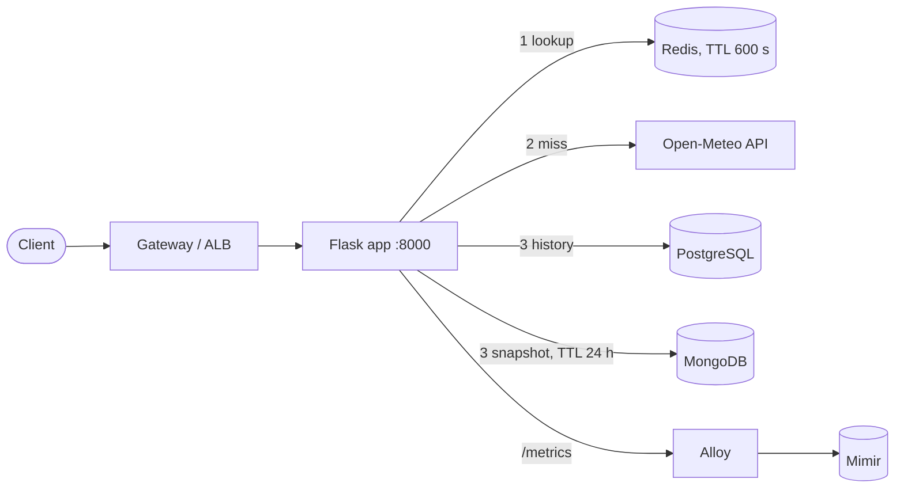

# weather-service

Flask weather lookup service with a Redis read-through cache, PostgreSQL lookup history and MongoDB snapshots. It is the workload deployed
by [eks-platform-gitops](https://github.com/manoVaturi/eks-platform-gitops) onto the cluster built by
[eks-platform-infra](https://github.com/manoVaturi/eks-platform-infra). It runs live at `weather.manovaturi.com` (prod) and
`weather-dev.manovaturi.com` (dev) whenever the platform is up.

## Architecture



Request path for `GET /api/weather?city=X`: check Redis; on a miss call Open-Meteo, then write the answer to Redis, append a row to
PostgreSQL and store a snapshot in MongoDB. Each backend is optional. A missing host disables the feature; a backend outage never fails a
lookup. If Open-Meteo is down the endpoint answers 503 and nothing is cached or recorded.

## Configuration

Environment variables, set by the Helm chart. Credentials come from Kubernetes Secrets synced from Vault.

| Variable | Purpose | Default when unset |
| --- | --- | --- |
| `APP_VERSION` | reported by `/healthz` and metrics | `unknown` |
| `REDIS_HOST`, `REDIS_PORT`, `CACHE_TTL_SECONDS` | cache | cache off, TTL 600 |
| `DB_HOST`, `DB_NAME`, `DB_USER`, `DB_PASSWORD` | PostgreSQL history | history off, `/api/history` returns 503 |
| `MONGO_HOST`, `MONGO_PORT`, `MONGO_DB`, `MONGO_USER`, `MONGO_PASSWORD`, `SNAPSHOT_TTL_SECONDS` | MongoDB snapshots | snapshots off, TTL 86400 |

## Endpoints

| Method | Path | Description |
| --- | --- | --- |
| GET | `/healthz` | liveness and readiness probe target |
| GET | `/api/weather?city=X` | current weather |
| GET | `/api/history` | recent lookups |
| GET | `/api/snapshots?city=X` | stored snapshots |
| POST | `/api/users` | create a user (name only) |
| GET, PUT, DELETE | `/api/users/<name>/favourites[/<city>]` | favourite cities |
| GET | `/metrics` | Prometheus metrics; blocked at the load balancer for public traffic |

Metrics: `flask_http_request_total`, `flask_http_request_duration_seconds`, `weather_city_lookups_total{city}`,
`weather_cache_hits_total`, `weather_cache_misses_total`.

## Layout

```text
.
├── Dockerfile          multi-stage build, non-root user (uid 10001)
├── Jenkinsfile         pipeline definition
├── requirements.txt
└── app/
    ├── main.py         Flask app wiring
    ├── routes/         health, weather, users, snapshots, pages
    ├── cache.py        Redis client
    ├── db.py           PostgreSQL access
    ├── snapshots.py    MongoDB access
    ├── monitoring.py   Prometheus metrics
    └── tests/          pytest suite with fakes for the backends
```

## Run locally

```bash
python -m venv .venv && . .venv/bin/activate
pip install -r requirements.txt
python -m pytest app/tests
flask --app app.main run --port 8000
curl -s localhost:8000/healthz
```

Without backend variables the app runs with cache, history and snapshots disabled.

## CI/CD

| Stage | Action |
| --- | --- |
| Prepare, Test | install dependencies, run pytest |
| Build image, Security scan | Docker build, Trivy image scan |
| Push to ECR | tag `:<git sha>` |
| Update GitOps repo | on `main`: edit the dev image tag in eks-platform-gitops |
| Release | on tag `vX.Y.Z`: retag the built image and open a merge request for prod |

The source of truth is GitLab; a webhook with a shared secret triggers the pipeline. Registry placeholder in the Jenkinsfile:
`<AWS_ACCOUNT_ID>`.

## Known constraints

- Users have a name but no authentication; the API is a demonstration of the stateful backends, not an account system.
- Dev and prod share database instances in the current gitops configuration.
- Snapshots and history are disposable: the databases are rebuilt with the cluster.
